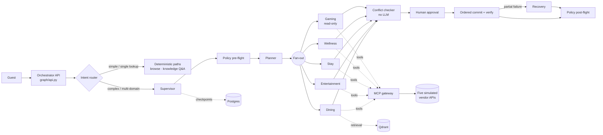

# ResortFlow — Multi-Agent Resort Concierge Platform

A multi-agent concierge platform for a two-property luxury resort group. A guest asks for
*"dinner somewhere good before the 8pm show, and a late checkout Sunday"*; ResortFlow plans it across
four independent vendor systems, holds the inventory, asks the guest to approve, commits the
bookings in a safe order, and repairs the plan if one of them fails.

It is a distributed-transaction problem with a natural-language front door, so most of the
engineering is about **what happens when something fails halfway**: holds, idempotency,
compensation, durable state, and policy that cannot be talked out of.

> **All data is fictional.** The client (Meridian Resorts International), its properties, guests,
> and all five vendor APIs are anonymized and simulated. Nothing in this repository connects to a
> real resort, casino, or reservation system.

| Tenant | Property | Jurisdiction |
|---|---|---|
| `MGV` | Meridian Grand, Las Vegas | Nevada Gaming Control Board |
| `MHB` | Meridian Harbor, Boston | Massachusetts Gaming Commission |

The two jurisdictions are deliberate: they force per-tenant *policy* (advertising limits,
self-exclusion enforcement, mandated messaging), not just per-tenant branding.

## Architectural commitments

1. **Ambiguity-based routing.** LLMs run only where intent is unbounded. Roughly 60% of traffic
   (hours, simple lookups, standard searches) is answered deterministically and never enters the
   agentic graph. Deterministic paths are also the degradation fallback.
2. **All tool access through MCP.** No agent holds a vendor SDK. One governed integration surface
   with typed schemas and per-tool scopes.
3. **Every external mutation is hold-then-confirm.** No agent performs an irreversible action in
   a single call, which is what makes compensation possible.
4. **Policy is not a prompt.** Allergen handling, responsible gaming, and jurisdiction rules are
   enforced in code, before and after the model.
5. **State is durable and inspectable.** Every graph step is checkpointed; any conversation can
   be replayed, resumed, or audited.

## Architecture



Key design points:

- **Supervisor with domain subgraphs.** Each domain (dining, entertainment, stay, wellness,
  gaming) is a separately compiled and separately evaluated LangGraph subgraph.
- **Saga with semantic compensation.** Holds are placed in parallel, committed sequentially
  riskiest-first, and a failed commit is repaired by finding an alternative that preserves the
  guest's intent, not by rolling everything back.
- **Write-ahead hold ledger.** External side effects are recorded in a ledger independent of the
  checkpointer, and holds are revalidated against the vendor on resume. A reaper releases orphans.
- **Deterministic conflict checking.** Travel-time and party-size feasibility is arithmetic, so it
  is code, not a model call.
- **Structured safety data.** Dietary restrictions travel as a typed enum plus severity and are
  asserted before commit; they are never carried only as free text.

The full write-up is in
[docs/ResortFlow-Enterprise-Multi-Agent-Plan.md](docs/ResortFlow-Enterprise-Multi-Agent-Plan.md), with the
reasoning behind each major decision recorded as an
[Architecture Decision Record](docs/adr/).

## Tech stack

| Concern | Choice |
|---|---|
| Orchestration | LangGraph (Python): supervisor and domain subgraphs |
| Checkpointing | Postgres via `langgraph-checkpoint-postgres`, with `EncryptedSerializer` |
| Retrieval | Qdrant: dense + BM25, reciprocal rank fusion, cross-encoder rerank |
| LLM | Azure OpenAI or Azure AI Foundry: `gpt-4.1-mini` by default, `gpt-4.1` for planner, recovery, and judge |
| Tools | MCP servers, one per domain, behind a single gateway |
| Vendor APIs | Five stateful, fault-injectable FastAPI simulators |
| Observability | OpenTelemetry; Langfuse locally, Azure Monitor and Foundry in production |
| PII | Presidio-based redaction at the trace-write boundary |
| Local environment | Docker Compose; everything runs offline except the LLM calls |

## Getting started

### Prerequisites

- Docker with Compose v2
- Python 3.11 or newer
- For anything that calls a model: an Azure OpenAI resource or an Azure AI Foundry project.
  Without credentials, LLM-dependent steps use their rule-based fallbacks where one exists, and
  the evaluation judge reports `INCOMPLETE` rather than inventing a score.

### Run the stack

```bash
git clone https://github.com/gtheonse/resortflow.git
cd resortflow
cp .env.example .env          # then fill in the LLM variables
pip install -e ".[dev]"
python -m spacy download en_core_web_sm

make up                       # infra + simulators + MCP gateway + orchestrator
make seed                     # seeds both tenants; generates a dev signing key if missing
make demo                     # a three-domain booking with an injected dining failure
```

`make demo` runs the scenario from the plan above: it requests dinner, a show, and a spa
treatment; places holds in all three systems; forces the dining confirmation to fail; and shows
the recovery agent proposing an alternative instead of cancelling everything.

### Verification console

A local, dev-only UI for typing a guest message and inspecting node order, tool calls, hold TTLs,
and guardrail verdicts:

```bash
python -m rag.indexer         # one-time: populate Qdrant (needs embedding credentials)
python -m ui.run              # http://localhost:8420
```

See [ui/README.md](ui/README.md) for details, including why `python -m ui.run` is used instead of
the plain uvicorn command on Windows.

### Services and ports

All ports are bound to `127.0.0.1`.

| Service | Port | Profile |
|---|---|---|
| Orchestrator API (`/v1/turns`, `/v1/threads/{id}`, `/healthz`) | 8100 | `app` |
| MCP gateway | 9100 | `app` |
| PMS / dining / ticketing / casino / amenities simulators | 9001–9005 | `sims` |
| Qdrant | 6333 | core |
| Postgres | 5432 | core |
| Redis | 6379 | core |
| Langfuse | 3000 | core |
| MinIO API / console | 9090 / 9091 | core |
| Azurite (blob / queue / table) | 10000–10002 | core |
| Service Bus emulator | 5672 | core |

> **Local development only.** Every credential in `docker-compose.yml` and `.env.example` is a
> throwaway value for a local stack. Do not expose these services to a network or reuse the values
> anywhere else. See [SECURITY.md](SECURITY.md).

## Testing and quality gates

```bash
make test-docker                  # full pytest suite in a Linux container (recommended on Windows)

pytest -m "not integration"       # unit tests on the host
ruff check .                      # lint
mypy                              # strict type check (scope set in pyproject.toml)

make eval                         # per-domain evaluation suites
python -m eval.runner --tier pr   # the evaluation gate that CI runs
```

Tests marked `integration` need LLM credentials, live simulators, or a running Langfuse and are
excluded from the default CI unit step.

The evaluation suite is the merge gate. CI runs it in three tiers (pull request, merge queue, and
nightly) as GitHub Actions workflows in [.github/workflows/](.github/workflows/). The judge model
is pinned and always at least as capable as the generator, so a regression cannot be hidden by a
weaker evaluator. The workflows read these repository secrets: `FOUNDRY_PROJECT_ENDPOINT`,
`FOUNDRY_JUDGE_DEPLOYMENT_NAME`, `AZURE_OPENAI_API_KEY`, and `AZURE_OPENAI_API_VERSION`. Without
them the PR tier degrades to warnings rather than failing.

## Repository layout

| Path | Contents |
|---|---|
| [agents/](agents/) | Domain subgraphs: dining, entertainment, gaming, stay, wellness |
| [graph/](graph/) | Orchestrator API, supervisor, routing, state, hold ledger, MCP client |
| [mcp/](mcp/) | MCP gateway and one tool server per domain |
| [sims/](sims/) | The five simulated vendor APIs and the seeder |
| [policy/](policy/) | Code-enforced guardrails: dietary, distress, gaming, injection, jurisdiction |
| [rag/](rag/), [content/](content/) | Retrieval pipeline and the per-tenant knowledge corpora |
| [eval/](eval/) | Evaluation runner, scorers, judge, and the statistical gate |
| [prompts/](prompts/) | Versioned prompt registry with an optional Langfuse mirror |
| [observability/](observability/) | Telemetry attributes, OpenTelemetry wiring, PII redaction |
| [ui/](ui/) | Dev-only verification console |
| [infra/](infra/), [docker/](docker/) | Hold-ledger reaper job, SQL init, container images |
| [docs/](docs/) | Architecture, ADRs, and the frozen API and tool contracts |
| [specs/](specs/) | Feature specifications, plans, and task lists |
| [tests/](tests/) | Cross-cutting tests |

## Documentation

| Read | For |
|---|---|
| [Architecture and build plan](docs/ResortFlow-Enterprise-Multi-Agent-Plan.md) | Business case, agent roster, state design, transaction model |
| [Supervisor architecture](docs/ResortFlow-Supervisor-Architecture.md) | Supervisor, saga participants, graph topology |
| [Durability and resume](docs/ResortFlow-HITL-Durability-State.md) | Checkpointing, hold ledger, human-in-the-loop, resume safety |
| [Observability deep dive](docs/ResortFlow-Observability-Tracing-Deep-Dive.md) | Tracing, dual-backend design, evaluation reporting |
| [Model tiering](docs/ResortFlow-Model-Tiering.md) | Why each node uses the model it does |
| [Cloud portability review](docs/ResortFlow-Cloud-Portability-Review.md) | What is coupled to Azure and what is not |
| [ADRs](docs/adr/) | The decisions behind the design, with options considered |
| [Contracts](docs/contracts/) | Frozen OpenAPI specs for the five vendors and the MCP tool contract |

Contributor and agent guidance is in [AGENTS.md](AGENTS.md); see also
[CONTRIBUTING.md](CONTRIBUTING.md).

## License

Apache License 2.0. See [LICENSE](LICENSE).
