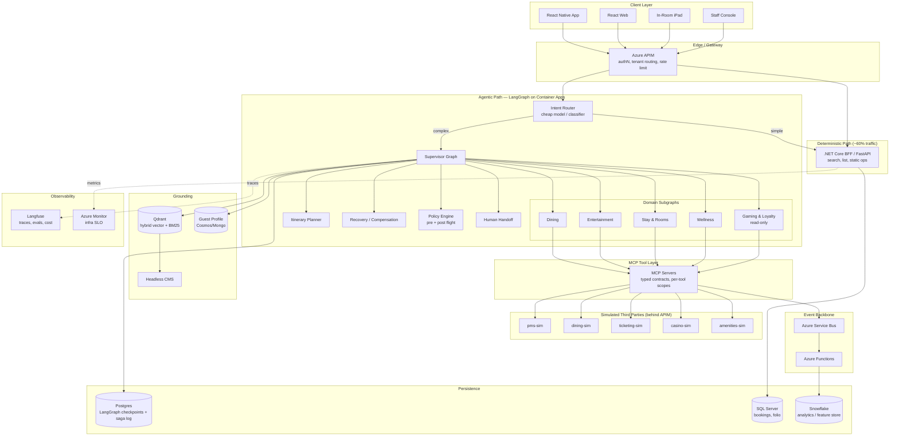
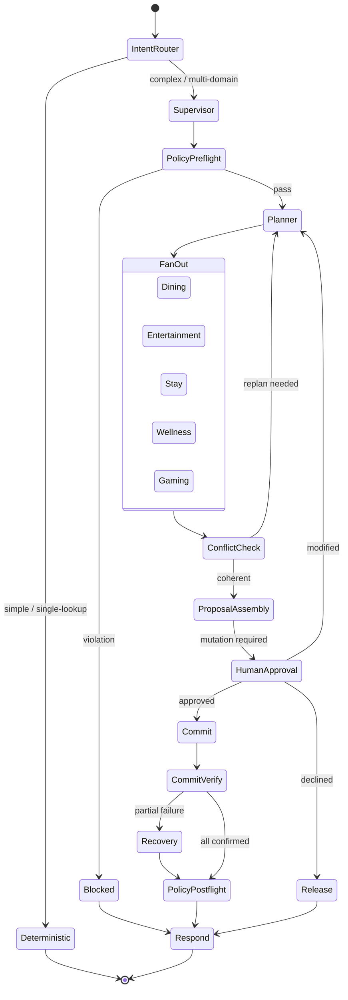

# ResortFlow — Multi-Agent Resort Concierge Platform
## Enterprise Multi-Agent Platform: Architecture and Build Plan

**Client (anonymized):** Meridian Resorts International (MRI)
**Tenants:**
- `MGV` — **Meridian Grand, Las Vegas** — 2,700-key integrated resort, casino floor, 3,000-seat theater, nightclub/dayclub, 5 signature restaurants, spa, golf course. Regulator: Nevada Gaming Control Board.
- `MHB` — **Meridian Harbor, Boston** — 900-key harbourfront resort, smaller casino floor, 600-seat venue, 3 restaurants, spa. Regulator: Massachusetts Gaming Commission.

> The two-jurisdiction detail is deliberate and load-bearing. It forces per-tenant *policy* (not just per-tenant *branding*) into the architecture, which is where the most interesting trade-offs live.

---

## Table of Contents

**PART I — THE SYSTEM**
1. [Business Case & Capability Map](#1-business-case--capability-map)
2. [Why Multi-Agent (and where it's the wrong answer)](#2-why-multi-agent-and-where-its-the-wrong-answer)
3. [Target Architecture](#3-target-architecture)
4. [Agent Roster & LangGraph Topology](#4-agent-roster--langgraph-topology)
5. [State Design](#5-state-design)
6. [The Transaction Problem: Holds, Sagas & Compensation](#6-the-transaction-problem-holds-sagas--compensation)
7. [Guardrails, Policy & Responsible Gaming](#7-guardrails-policy--responsible-gaming)
8. [Retrieval Architecture](#8-retrieval-architecture)
9. [Third-Party Simulation Strategy](#9-third-party-simulation-strategy)

**PART II — THE STACK**
10. [Cost-Optimized Component Selection](#10-cost-optimized-component-selection)
11. [Local-First Development Environment](#11-local-first-development-environment)
12. [Azure Deployment Target & Cost Model](#12-azure-deployment-target--cost-model)

**PART III — THE BUILD**
13. [Phase Plan (0–8)](#13-phase-plan-08)
14. [Parallel Execution Model](#14-parallel-execution-model)
15. [ADR Register](#15-adr-register)

---

# PART I — THE SYSTEM

## 1. Business Case & Capability Map

### The business problem, stated properly

An integrated resort makes money across a dozen revenue lines — rooms, F&B, entertainment, spa, retail, gaming — but the guest experiences them as **one stay**. The systems don't. Rooms live in the PMS, dining in SevenRooms, tickets in Ticketmaster, loyalty in the casino management system, spa in a separate scheduler. A guest wanting "dinner somewhere good before the 8pm show, and can you sort a late checkout" is initiating a four-system transaction that today requires a human concierge.

Concierge headcount doesn't scale to 3,600 keys across two properties, and it doesn't operate at 2am, and it doesn't remember that this guest was here in March and disliked the seafood tower.

**The commercial thesis:** guests who book 3+ on-property experiences in a stay spend materially more and rate the stay higher. The constraint on that isn't demand — it's friction. Every additional booking is another app, another phone call, another queue at the desk. ResortFlow's job is to collapse that friction into one conversation that can actually *act*.

**The architectural thesis:** this is not a chatbot problem. It's a **distributed transaction problem with a natural-language front door**. That reframe moves the design conversation from "prompt engineering" to "systems engineering": idempotency, compensation, and durable state matter far more than prompt wording.

### Capability map — what ResortFlow actually integrates

| Domain | Capability | Source system | Transactional? |
|---|---|---|---|
| **Stay** | Room search, book, modify, cancel | PMS | Yes — money |
| | Upgrade offers, early check-in, late checkout | PMS | Yes — inventory |
| | Room service, housekeeping, maintenance requests | PMS / service desk | Yes — fulfilment |
| | Folio / charges enquiry | PMS | Read |
| **Dining** | Venue discovery, availability, book/modify/cancel | SevenRooms-equivalent | Yes — inventory |
| | Dietary & allergen requirements, occasion tagging | SevenRooms-equivalent | Yes — safety-critical |
| | Waitlist / walk-in queue | SevenRooms-equivalent | Yes |
| | Venue-hosted events (chef's table, wine dinners) | SevenRooms-equivalent | Yes |
| **Entertainment** | In-resort theater & venue events | Ticketmaster-equivalent | Yes — money |
| | Off-property events (city-wide inventory) | Ticketmaster-equivalent | Yes — money |
| | Seat selection, holds, purchase | Ticketmaster-equivalent | Yes — money |
| | Nightclub / dayclub table service | In-house venue system | Yes |
| **Wellness** | Spa treatment discovery & booking | Amenities system | Yes |
| | Fitness classes, pool cabana reservations | Amenities system | Yes |
| | Golf tee times | Amenities system | Yes |
| **Gaming** | Casino floor info, game availability, tournament schedule | Casino mgmt system | **Read only** |
| | Loyalty tier, points balance, comp offers | Casino mgmt system | Read + offer redemption |
| | Responsible gaming status & resources | Casino mgmt system | **Policy-critical** |
| **Journey** | Airport transfer, on-property transport | Transport partner | Yes |
| | Itinerary assembly & conflict detection | ResortFlow-native | N/A |
| | Proactive disruption handling (show cancelled, venue closed) | ResortFlow-native | N/A |
| **Knowledge** | Property info, hours, policies, directions, FAQs | Headless CMS → RAG | Read |

### Scope boundary

**ResortFlow never places a wager and never handles gaming transactions.** The gaming domain is read-only (facility information, loyalty balance, tournament schedules, responsible-gaming resources). This is a deliberate scope decision, not an oversight — putting a probabilistic system anywhere near a regulated wagering transaction is unacceptable.

---

## 2. Why Multi-Agent (and where it's the wrong answer)

The position taken here is that **multi-agent is a cost, and the design must name what it buys.**

### What a single agent with 40 tools actually fails at

1. **Tool-selection accuracy degrades with tool count.** Past roughly 15–20 tools in one context, selection accuracy falls off measurably. ResortFlow has ~45 tools across six domains. A flat tool list is a recipe for the model calling `spa.book` when it meant `dining.book`.
2. **Context window economics.** Every tool schema, every domain's business rules, every policy fragment in one prompt = expensive and slow on *every* turn, even a turn that only needed the dining domain.
3. **Independent evaluation is impossible.** With one agent, you can only measure end-to-end success. You cannot answer "is the dining logic regressing?" With domain subgraphs, each has its own eval set and its own pass/fail gate in CI.
4. **Blast radius.** A prompt change to improve upsell phrasing should not be able to alter how allergen requirements are transmitted to a kitchen. Separate agents give you separate deployment and separate rollback.
5. **Parallelism.** "Dinner and a show and a spa slot" — three independent availability lookups. A single agent serializes them. A supervisor with fan-out runs them concurrently, which is the difference between 9 seconds and 3.

### Where multi-agent is the *wrong* answer

- **Simple, single-domain, deterministic requests.** "What time does the pool close?" should never enter the graph. It's a cache hit or a single RAG lookup.
- **High-frequency, low-ambiguity flows.** Standard date-range room search stays as a conventional API + UI path. No LLM.
- **Anything where latency budget < ~1.5s.** Multi-hop agent graphs cost latency; that cost is accepted only where the request needs it.

The routing principle: *"We route by ambiguity, not by capability. A request only enters the agentic path when intent is unbounded or the request spans systems. Roughly 60% of traffic never touches an LLM at all — and that's a design goal, not a limitation."*

### The counter-position

Is this over-engineered? For a single property with one integration, yes. The multi-agent structure earns its cost at two thresholds: when tool count exceeds what a single context can select from reliably, and when domain teams need to ship independently. Both thresholds are crossed here. At one property and around 12 tools, a single ReAct agent with a good tool router would be the better choice.

---

## 3. Target Architecture



### The five architectural commitments

Everything else follows from these. Do not violate them without an ADR.

1. **Ambiguity-based routing.** LLMs are used where intent is unbounded. Deterministic paths remain first-class and are the fallback when the agentic layer degrades.
2. **All tool access through MCP.** No agent holds a vendor SDK. One governed integration surface, typed schemas, per-tool scopes, uniform audit.
3. **Every external mutation is a two-phase hold-then-confirm.** No agent performs an unreversible action in a single call. This is what makes compensation possible.
4. **Policy is not a prompt.** Compliance rules (allergen handling, responsible gaming, jurisdiction) are enforced in code, before and after the model, never by instruction alone.
5. **State is durable and inspectable.** Every graph step is checkpointed. Any conversation can be replayed, resumed, or audited.

---

## 4. Agent Roster & LangGraph Topology

### The topology

Supervisor pattern with **domain subgraphs**. Each domain is a compiled LangGraph subgraph exposed to the supervisor as a callable node — so it can be developed, tested, versioned, and evaluated independently.



### Agent responsibilities

| Node / Agent | Type | Responsibility | Model tier |
|---|---|---|---|
| **Intent Router** | Classifier | Decide deterministic vs agentic; detect domain set; detect safety-sensitive intents | Small/cheap (or fine-tuned classifier — no LLM at all is valid) |
| **Supervisor** | LangGraph StateGraph | Owns conversation state, routing, fan-out/fan-in, replan loop, termination | Frontier |
| **Planner** | Node | Decompose intent → ordered/parallel task list with dependencies and constraints (e.g. dinner must end ≥45min before curtain) | Frontier |
| **Dining subgraph** | ReAct subgraph | Venue discovery, availability, dietary/allergen capture, hold, confirm | Mid |
| **Entertainment subgraph** | ReAct subgraph | In-resort + external event discovery, seat selection, hold, purchase | Mid |
| **Stay subgraph** | ReAct subgraph | Room ops, upgrades, checkout timing, service requests | Mid |
| **Wellness subgraph** | ReAct subgraph | Spa, fitness, cabana, golf | Mid |
| **Gaming & Loyalty** | ReAct subgraph, **read-only tools** | Facility info, tier/points, tournament schedule, RG resources | Mid + hard policy gate |
| **Conflict Checker** | Deterministic node — **no LLM** | Temporal/geographic feasibility across proposed items; travel time between venues; party-size consistency | None |
| **Offer Agent** | Node | Contextual upgrade/package suggestions from Snowflake feature store | Mid |
| **Policy Engine** | Deterministic service | Pre-flight: intent screening, entitlement, jurisdiction. Post-flight: groundedness, PII, allergen-fidelity, RG compliance | Rules + small model for groundedness |
| **Recovery Agent** | Subgraph | Executes compensation plan on partial failure; proposes alternatives | Frontier |
| **Human Handoff** | Interrupt node | Escalate to live concierge with full state snapshot | None |

### Why the Conflict Checker has no LLM

This is a deliberate decision to keep AI out of the system.

Checking whether a 6:30pm dinner reservation at a venue 400m from the theater leaves enough time for an 8pm curtain is arithmetic. It has a correct answer. An LLM will get it right ~95% of the time; a function gets it right 100% of the time, in 2ms, for free, and is unit-testable. Putting a model there would be architecture-by-fashion.

**The general principle:** *"The model's job is to handle ambiguity. The moment ambiguity is resolved into concrete values, the work belongs in deterministic code. We push the LLM boundary as early in the pipeline as possible."*

---

## 5. State Design

Most write-ups of agent systems describe the agents. The harder part is **state**: what is stored, who may write it, and what survives a crash.

### The state object

```python
class ResortFlowState(TypedDict):
    # Identity & tenancy — set once at entry, never mutated
    tenant_id: str                      # MGV | MHB
    guest_id: str
    session_id: str
    jurisdiction: str                   # NV | MA — drives policy
    entitlements: list[str]             # loyalty tier, comp eligibility

    # Conversation
    messages: Annotated[list[Message], add_messages]

    # Planning
    plan: Plan | None                   # tasks, dependencies, constraints
    replan_count: int                   # circuit breaker on planning loops

    # Domain results — parallel-safe reducers
    proposals: Annotated[list[Proposal], merge_proposals]
    holds: Annotated[list[Hold], merge_holds]        # id, expiry, system, idempotency_key
    confirmations: Annotated[list[Confirmation], append_only]
    failures: Annotated[list[ToolFailure], append_only]

    # Grounding
    retrieved: Annotated[list[Chunk], dedupe_by_id]
    citations: list[Citation]

    # Control
    awaiting_approval: bool
    approval_scope: list[str]           # which mutations need the human yes
    policy_flags: list[PolicyFlag]
    escalate: bool
    saga_log: Annotated[list[SagaEvent], append_only]
```

### The three key state design decisions

**1. Why reducers instead of plain overwrites.**
When Dining, Entertainment and Wellness run in parallel, all three write to `proposals` in the same superstep. Without a reducer, last-write-wins and you silently lose two of three results. `Annotated[list, merge_proposals]` makes concurrent writes explicit and correct. This is the single most common bug in hand-rolled multi-agent systems.

**2. Why `holds` is in state and not just in the external systems.**
Holds expire. If the graph is checkpointed and resumed 20 minutes later, the resume logic must know which holds are still live before it commits. Keeping hold IDs + expiry in state makes resume-safety a property of the graph, not a hope. It also means the compensation path knows exactly what to release without querying five systems.

**3. Why `replan_count` exists.**
Planner → fan-out → conflict → replan is a cycle. Cycles in LangGraph are legal and useful; unbounded cycles are an outage. Hard cap at 3, then escalate to human. Every cyclic graph in production needs an explicit termination guarantee; here it is the `replan_count` cap.

### Checkpointing

- **Postgres checkpointer** (`langgraph-checkpoint-postgres`) — local Docker in dev, Azure Database for PostgreSQL Flexible Server (Burstable B1ms) in Azure.
- **Thread ID = session ID**, so a guest can close the app mid-flow and resume.
- **Checkpoint after every superstep**, not every node — balance between durability and write volume.
- **Time-travel** is genuinely useful here: replaying a conversation to the state before a bad tool call is how you debug agent behaviour in production. It is used operationally, not just as a framework feature.

**Why Postgres and not Redis for checkpoints:** checkpoints are the audit trail for money-moving conversations. They need durability and queryability, not just speed. Redis is used separately for semantic cache and hold-expiry timers, where volatility is fine.

---

## 6. The Transaction Problem: Holds, Sagas & Compensation

**This is the heart of the system** and its hardest part.

### The problem

Guest asks: *"Dinner at Lumière at 6:30, two tickets to the 8pm show, and a late checkout Sunday."*

Three systems. Three separate APIs, none of which participate in a shared transaction. There is no two-phase commit across SevenRooms, Ticketmaster and the PMS, and there never will be.

Failure modes:
- Tickets purchase succeeds, dining fails → guest has a show and no dinner.
- Dining succeeds, tickets sell out during the turn → guest has dinner and no show.
- Everything succeeds but the guest says "actually no" → three bookings to unwind.
- Network partition mid-commit → unknown state.

### The pattern: hold → propose → approve → commit → verify → compensate

```mermaid
sequenceDiagram
    participant G as Guest
    participant S as Supervisor
    participant D as Dining
    participant E as Entertainment
    participant P as PMS
    participant R as Recovery

    Note over S: Phase 1 — parallel HOLD (reversible)
    par
        S->>D: hold(venue, 18:30, party 2) TTL 10m
        D-->>S: hold_id=D1, expires 18:41
    and
        S->>E: hold(event, 2 seats) TTL 8m
        E-->>S: hold_id=E1, expires 18:39
    and
        S->>P: hold(late_checkout, 14:00) TTL 15m
        P-->>S: hold_id=P1, expires 18:46
    end

    Note over S: Phase 2 — conflict check (deterministic)
    S->>S: travel time 400m = 6min; 6:30 dinner → 8pm curtain OK

    Note over S,G: Phase 3 — human approval (interrupt)
    S->>G: "Here's the plan. Total $487. Confirm?"
    G->>S: approve

    Note over S: Phase 4 — sequential COMMIT, riskiest first
    S->>E: confirm(E1, idempotency_key)
    E-->>S: CONFIRMED
    S->>D: confirm(D1, idempotency_key)
    D-->>S: FAILED — table released
    S->>P: confirm(P1, idempotency_key)
    P-->>S: CONFIRMED

    Note over S,R: Phase 5 — partial failure → compensate
    S->>R: saga_log + failure
    R->>D: find alternatives 18:00-19:15
    D-->>R: 19:00 available (leaves 55min)
    R->>G: "Lumière lost the 6:30. 7:00 works — still comfortable for the show. Or I can cancel the tickets."
```

### The five decisions inside this pattern

**1. Why hold-then-confirm rather than direct booking.**
It converts an irreversible distributed transaction into a reversible one. Holds expire on their own, so the failure mode of "agent crashed mid-flow" is self-healing — inventory returns to the pool without any cleanup job. Direct booking makes every crash a manual remediation ticket.

**2. Why commit is sequential, not parallel — and ordered riskiest-first.**
Parallel commit maximizes the window where you have partial success and no information. Sequential commit means you fail fast and know exactly where you stopped. Ordering by *scarcity and irreversibility* (event tickets are scarcest and hardest to re-acquire; late checkout is trivially re-requestable) means the expensive failure happens first, when the compensation cost is lowest.

**3. Why compensation is semantic, not mechanical.**
A rollback engine would cancel everything. That's wrong for a guest. If dinner fails, the right move is usually *find another table*, not *cancel the show*. The Recovery agent's job is to preserve as much of the guest's intent as possible and present a real choice. This is where an LLM genuinely earns its place — "what's the best partial outcome here" is a judgment call, not a rule.

**4. Why idempotency keys are non-negotiable.**
Agents retry. Networks partition. A confirm call that times out may or may not have succeeded. Every mutating MCP tool takes a client-generated idempotency key derived from `(session_id, hold_id, attempt)`. The sims must honour it — that's not test scaffolding, it's contract enforcement, and it's why the mocks need to be stateful.

**5. Why human approval sits before commit, always.**
Holds are reversible and cost nothing. Commits move money. The interrupt goes exactly at the reversible/irreversible boundary. That is the *only* principled place to put it — earlier is annoying, later is dangerous.

### LangGraph mechanics

- `interrupt()` before the commit node, resumed with `Command(resume=...)`.
- Approval scope is granular: a guest can approve dinner and decline the show; the graph commits a subset and releases the rest.
- The saga log is append-only in state *and* mirrored to Postgres, so compensation survives process death.

### When compensation itself fails

Compensation failures stop retrying and write to a dead-letter queue with the full saga log. The on-property duty manager is paged with a structured summary, and the guest gets an honest message — "I've booked your show but I'm having trouble with the restaurant; a member of our team will call you within ten minutes." The system's obligation is not to always succeed; it is to never leave the guest in an unknown state. Silent partial failure is the only unacceptable outcome.

---

## 7. Guardrails, Policy & Responsible Gaming

### Layered enforcement

| Layer | Runs | Enforces | Fails how |
|---|---|---|---|
| **Input screening** | Before graph | Prompt injection, jailbreak, off-domain, distress signals | Reject / redirect |
| **Entitlement gate** | Pre-flight, deterministic | Tenant, loyalty tier, jurisdiction, self-exclusion | Blocked with neutral message |
| **Tool schema validation** | Every tool call | Typed args, range checks, tenant scope | Reject call, force retry |
| **Allergen fidelity check** | Dining commits only | Structured dietary field matches conversation | Block + escalate |
| **Groundedness scoring** | Post-generation | Claims supported by retrieved context | Regenerate / strip claim |
| **PII redaction** | Trace + log write | Presidio-based | Redact before persist |
| **Responsible gaming policy** | Any gaming-adjacent turn | Jurisdiction rules, self-exclusion, no promotion | Suppress + surface resources |

### Allergen handling — the safety-critical path

A guest says "my wife has a severe shellfish allergy." That must arrive at the kitchen as a **structured field**, not as free text in a notes blob that a model paraphrased.

Design:
- Dietary requirements extracted into a typed enum + severity + free-text detail.
- The structured field is what goes to the dining API. The prose is carried alongside, never instead.
- A post-flight check re-reads the conversation and asserts every stated restriction appears in the structured payload. Mismatch = hard block + human escalation.
- The guest confirmation message must echo the restriction back verbatim.

**Why this matters:** this is the clearest case of refusing to trust the model. Generic groundedness scoring does not protect a safety-critical field; a typed field with a structural post-flight check does.

### Responsible gaming — the hardest trade-off

Two jurisdictions, two rulebooks. Nevada and Massachusetts differ on advertising restrictions, self-exclusion enforcement, and mandated responsible-gaming messaging. The architecture must express this as **per-tenant policy configuration**, not per-tenant prompts.

Hard rules encoded in the Policy Engine:
1. ResortFlow never initiates gaming promotion. It answers gaming questions; it does not raise the topic.
2. Self-exclusion list check runs before *any* gaming-domain tool executes — and before the Offer Agent runs at all, on every turn, regardless of topic.
3. The Offer Agent is structurally forbidden from emitting gaming-linked offers. Not discouraged by prompt — the tool simply isn't in its registry.
4. Jurisdiction-mandated messaging is appended deterministically, not generated.
5. Any guest utterance suggesting gambling-related distress routes immediately to human handoff with responsible-gaming resources surfaced. No model judgment involved in that route.

**The trade-off:** the revenue-optimization agent is a commercial reason the platform exists, and it is deliberately constrained in the highest-margin domain on the property. A single instance of an AI concierge nudging a self-excluded guest toward the floor is an existential regulatory event for a licensed operator, so the expected-value calculation is not close. The constraint therefore lives in the tool registry, where no prompt change can undo it, rather than in instructions where a well-meaning optimization could.

---

## 8. Retrieval Architecture

### What actually gets retrieved

| Corpus | Volatility | Strategy |
|---|---|---|
| Property info, policies, directions, FAQs | Low | Vector + BM25 hybrid, nightly refresh |
| Restaurant menus, hours, dress codes | Medium | Hybrid, 4-hourly refresh from CMS |
| Event catalog (in-resort + external) | High | **Not RAG — live API.** Cached 5 min |
| Live availability | Real-time | **Never RAG — always live tool call** |
| Guest history & preferences | Per-guest | Structured lookup + summarized profile, not vector search |

**The discipline is knowing what *doesn't* belong in the vector store.** Availability in a vector index is a guaranteed hallucination and a guaranteed angry guest.

### Hybrid retrieval

- **Dense:** `text-embedding-3-large`, 3072-dim.
- **Sparse:** BM25 — essential here because guests use exact proper nouns (venue names, show titles, dish names) where dense retrieval is weak.
- **Fusion:** Reciprocal Rank Fusion, then cross-encoder re-rank top-30 → top-5.
- **Tenant isolation:** payload filter on `tenant_id` applied at the Qdrant query level, injected by the retrieval service from the token claim — never from anything the model produces. Non-negotiable.

### Chunking

Structure-aware, not fixed-size. Menus chunk per section; policies per clause; venue descriptions whole. Every chunk carries `tenant_id`, `venue_id`, `valid_from/to`, `source_uri`, `content_hash`.

Time-bounded content (seasonal menus, event-period policies) is filtered by `valid_from/to` at query time — a stale-content bug here means the concierge confidently recommends a closed restaurant.

---

## 9. Third-Party Simulation Strategy

Sandbox access to a ticketing platform, a restaurant reservation system, a property management system, and a casino management system is not generally available. Building faithful simulators is not a compromise — **it makes failure injection deterministic**, which the saga and compensation tests depend on.

### Design principles for the sims

1. **Stateful, not stub.** Real inventory that depletes. Holds that expire. Idempotency that's honoured. A Prism-style static mock cannot demonstrate a saga.
2. **OpenAPI-first.** Spec written before implementation; MCP tool schemas generated from it.
3. **Deliberately inconsistent between vendors** — different auth schemes, different pagination, different date formats, different error shapes. This is the *point*: the MCP layer's value is normalizing that mess, and a test environment where all five APIs look identical proves nothing.
4. **Failure injection as a first-class API.** `X-Sim-Fault: timeout | 500 | rate_limit | hold_expired | inventory_race` — so compensation can be exercised on demand, deterministically.
5. **Configurable latency profiles** — p50/p95/p99 per endpoint, so latency budget work is real.
6. **Webhooks** for async confirmations (Ticketmaster-style delayed fulfilment) to justify the Service Bus + Functions path.

### The five simulators

| Sim | Models | Auth style | Deliberate quirk |
|---|---|---|---|
| `pms-sim` | Rooms, rates, folio, service requests, checkout | OAuth2 client credentials | Verbose XML-ish JSON, legacy field names |
| `dining-sim` | Venues, availability, reservations, dietary, waitlist | API key header | Slot-based availability, strict party-size rules |
| `ticketing-sim` | Events (in-resort + city), seat maps, holds, purchase | OAuth2 + HMAC signature | Async purchase via webhook, aggressive rate limits |
| `casino-sim` | Loyalty tier, points, comps, tournaments, RG status | mTLS-style bearer | Read-only; RG status endpoint is authoritative |
| `amenities-sim` | Spa, fitness, cabana, golf | Basic auth | Practitioner-constrained availability, gender-preference fields |

All five run in Docker locally, deploy to Azure Container Apps, and sit behind APIM so the gateway policies (rate limiting, tenant routing, key management, request transformation) are exercised for real.

The five-service environment reproduces the failure modes of real hospitality vendors — expiring holds, rate limits, async webhook fulfilment, inconsistent auth — because the architecture is mostly about surviving those failures.

---

# PART II — THE STACK

## 10. Cost-Optimized Component Selection

The rule: **open source in Docker wherever the managed service is only buying convenience; managed Azure wherever it's buying compliance, durability, or something genuinely hard.**

| Need | Build choice | Production target | Why the split |
|---|---|---|---|
| Vector store | **Qdrant** (Docker) | Azure AI Search | Qdrant is free, runs on a laptop, has excellent hybrid + payload filtering. Azure AI Search Basic is ~$75/mo with no free local emulator. Documented as production target for the managed-service, integrated-security argument. |
| Checkpointer | **Postgres 16** (Docker) | Azure DB for PostgreSQL Flexible (B1ms) | Same engine both sides. B1ms ≈ $13/mo. |
| Cache / semantic cache | **Redis** (Docker) | Azure Cache for Redis Basic C0 | ~$16/mo, or keep Redis in a container to save it entirely. |
| Observability & evals | **Langfuse self-hosted** (Docker) | Langfuse on Container Apps | Free, OTel-compatible, purpose-built for LLM traces. Azure Monitor stays for infra SLO — the two are complementary, not competing. |
| Blob / queue | **Azurite** (Docker) | Azure Storage | Official emulator, exact API parity. |
| Service Bus | **Service Bus emulator** (Docker) or RabbitMQ | Azure Service Bus Standard | ~$10/mo Standard. Emulator covers local. |
| Identity | **Local JWT issuer** (Docker) | Microsoft Entra ID / B2C | Dev tokens carry the same claims shape (`tenant_id`, `jurisdiction`, tier) so no code differs. |
| Gateway | **FastAPI edge shim** locally | Azure APIM | No free local APIM. Shim replicates the *policies* (auth, tenant routing, rate limit) so behaviour is testable; APIM Consumption tier (~pay-per-call) for the deployed demo. |
| LLM | **Azure OpenAI** — gpt-4.1-mini default, gpt-4.1 for frontier nodes | Same | The one thing worth paying for. Provider abstraction allows Ollama locally for offline dev. |
| Embeddings | `text-embedding-3-large` | Same | Cheap enough (~$0.13/M tokens) that local substitution isn't worth the fidelity loss. |
| Compute | Docker Compose | **Azure Container Apps** (scale-to-zero) | AKS is the wrong call at this scale. Container Apps scale-to-zero keeps idle cost near zero. |

### The model tiering strategy

| Node | Model | Rationale |
|---|---|---|
| Intent Router | gpt-4.1-mini (or a fine-tuned classifier) | High volume, narrow task |
| Domain subgraphs | gpt-4.1-mini | Constrained tool selection within one domain |
| Planner, Recovery | gpt-4.1 | Genuine multi-step reasoning |
| Groundedness judge | gpt-4.1 | Judge must be at least as strong as generator |
| Conflict checker | **none** | Deterministic |

Roughly 80% of node executions are expected to run on the cheap tier. Cost per conversation drops roughly 5x versus routing everything to a frontier model, and quality is expected to be indistinguishable on the constrained nodes because the hard part — deciding what to do — already happened upstream in the planner. See [`ResortFlow-Model-Tiering.md`](ResortFlow-Model-Tiering.md).

The judge model is the one place the design refuses to economize: if the evaluator is weaker than the generator, eval metrics are decorative.

### Total running cost

Local: **$0** except Azure OpenAI tokens (~$5–15/mo at development volume).
Deployed reference environment: **~$40–70/mo** with Container Apps scale-to-zero, APIM Consumption, Postgres B1ms.

---

## 11. Local-First Development Environment

Everything runs on a developer laptop. This is a hard requirement and it shapes several decisions above.

```
docker-compose.yml
├── qdrant                 :6333   vector store
├── postgres               :5432   checkpoints + saga log
├── redis                  :6379   cache + hold timers
├── langfuse + clickhouse  :3000   traces, evals, cost
├── azurite                :10000  blob/queue emulator
├── servicebus-emulator    :5672   async backbone
├── jwt-issuer             :8080   local Entra stand-in
├── edge-shim              :8000   APIM policy stand-in
├── pms-sim                :9001
├── dining-sim             :9002
├── ticketing-sim          :9003
├── casino-sim             :9004
├── amenities-sim          :9005
├── mcp-gateway            :9100   MCP servers, one per domain
└── resortflow-orchestrator      :8100   LangGraph app (FastAPI)
```

`make up` → full environment. `make seed` → load two tenants of content, 50 synthetic guest profiles, inventory. `make eval` → run the eval suite. `make demo` → scripted multi-domain booking with injected dining failure, so you can show compensation live.

**Config parity:** identical code paths local and cloud; only connection strings and the model provider differ. If a behaviour only reproduces in Azure, the abstraction is wrong.

---

## 12. Azure Deployment Target & Cost Model

| Component | Azure service | Tier | Notes |
|---|---|---|---|
| Orchestrator, sims, MCP servers | Container Apps | Consumption, scale-to-zero | Right-sized; AKS deliberately rejected |
| Gateway | APIM | Consumption | Pay-per-call, no idle cost |
| Checkpoints | PostgreSQL Flexible | B1ms | |
| Vector | Qdrant on Container Apps | — | Azure AI Search documented as production target |
| LLM | Azure OpenAI | PAYG | PTU documented as production answer for latency guarantees |
| Events | Service Bus | Standard | Sessions needed for ordered guest events |
| Async handlers | Functions | Consumption | Webhooks, embedding refresh |
| Secrets | Key Vault | Standard | |
| Identity | Entra ID / B2C | — | |
| Infra SLO | Azure Monitor | — | Langfuse for agent-level telemetry |

### Why Container Apps, not AKS

AKS is the right answer at genuine scale — VNET granularity, custom scheduling, GPU pools, service mesh. This system has none of those requirements. Container Apps provides KEDA scale-to-zero, revision-based canary, managed ingress, and Dapr if needed, at a fraction of the operational cost. The migration path to AKS exists if scale demands it; the trigger would be a concrete requirement such as sustained multi-region traffic or a hard VNET requirement.

---

# PART III — THE BUILD

## 13. Phase Plan (0–8)

Each phase is specified under `specs/` (spec, plan, tasks) and records its decisions as ADRs in `docs/adr/`.

---

### Phase 0 — Foundations & Contracts
**Goal:** everything downstream depends on decisions made here, so nothing else starts until contracts are frozen.

- Repo structure, `constitution.md`, `mission.md`, `tech-stack.md`, `roadmap.md`
- Domain model: Guest, Stay, Proposal, Hold, Confirmation, SagaEvent, Plan, PolicyFlag
- **Canonical state schema** (`ResortFlowState`) with reducers — this is the contract every parallel track binds to
- OpenAPI specs for all five sims (design only, no implementation)
- MCP tool contract standard: naming, idempotency, error taxonomy, scope model
- Error taxonomy: `Retryable | Terminal | RequiresHuman | PolicyBlocked`
- docker-compose skeleton
- ADR-001 through ADR-006

**Exit criteria:** OpenAPI specs lint clean; state schema imports and type-checks; every downstream track can code against a frozen interface.

---

### Phase 1 — Simulation Ecosystem
**Goal:** a realistic, hostile integration environment.

- Five FastAPI sims, stateful, with seeded inventory
- Hold/expiry semantics with TTL, idempotency key enforcement
- Fault injection middleware (`X-Sim-Fault`), latency profiles
- Webhook emitter for async ticket fulfilment
- Deliberately divergent auth per sim
- Seed data: 2 tenants, 8 venues, 40 events, 200 rooms, 60 spa slots, 50 guest profiles

**Exit criteria:** every sim passes a contract test suite; a scripted hold→expire→release cycle runs unattended; faults are reproducible by header.

---

### Phase 2 — MCP Tool Layer
**Goal:** the governed integration surface.

- One MCP server per domain (dining, entertainment, stay, wellness, gaming)
- Tools generated from OpenAPI, hand-refined for agent ergonomics (fewer, richer tools beat many thin ones)
- Per-tool scopes; tenant claim injected server-side, never model-supplied
- Idempotency key generation, retry with jitter, circuit breaker per upstream
- Normalized error taxonomy across five inconsistent vendors
- Tool-level tracing to Langfuse

**Exit criteria:** MCP inspector lists all tools with valid schemas; a tenant-crossing call is impossible by construction (proved by test); upstream 500s surface as typed retryable errors.

---

### Phase 3 — Grounding & Retrieval
**Goal:** correct, tenant-isolated, freshness-aware knowledge.

- Content corpus for both tenants (menus, policies, venue descriptions, directions, FAQs)
- Structure-aware chunking; metadata with validity windows
- Qdrant collections with tenant payload filtering
- Hybrid retrieval: dense + BM25 + RRF + cross-encoder re-rank
- Retrieval eval set: 60 questions with gold chunks; context recall/precision baseline
- Explicit negative tests: availability questions must *not* be answerable from the index

**Exit criteria:** context recall ≥ 0.85 on the eval set; zero cross-tenant leakage across 200 adversarial probes.

---

### Phase 4 — Vertical Slice: Dining
**Goal:** one domain, end-to-end, correct — before any multi-agent complexity.

- Dining subgraph: ReAct loop over dining MCP tools
- Full flow: discovery → availability → dietary capture → hold → approval interrupt → confirm
- Postgres checkpointer wired; resume-after-restart proven
- Structured dietary extraction + allergen fidelity check
- Langfuse tracing end-to-end
- 25-case eval set for the dining domain

**Exit criteria:** a booking completes from cold start; kill the process mid-flow and resume correctly; allergen mismatch is blocked.

---

### Phase 5 — Multi-Agent Orchestration
**Goal:** the supervisor, the parallelism, the sagas.

- Supervisor StateGraph, intent router, planner
- Remaining four domain subgraphs
- Parallel fan-out with correct reducers (this is where the merge bugs live — test it hard)
- Deterministic conflict checker with travel-time matrix
- Saga: sequential ordered commit, verification, partial-failure detection
- Recovery agent with semantic compensation
- Replan cycle with hard bound + human escalation

**Exit criteria:** three-domain booking succeeds; injected dining failure produces a sensible alternative rather than a blanket rollback; replan loop terminates under adversarial input.

---

### Phase 6 — Policy, Guardrails & HITL
**Goal:** the parts that make it deployable in a regulated business.

- Policy Engine: pre-flight and post-flight, jurisdiction-aware
- Responsible gaming rules, self-exclusion enforcement, offer-registry restriction
- Prompt-injection screening; injection corpus in RAG content as a red-team test
- Presidio PII redaction on trace/log write paths
- `interrupt()` HITL with granular approval scope
- Human handoff with full state snapshot

**Exit criteria:** self-excluded guest receives zero gaming-adjacent content across a 40-turn adversarial script; injected prompt in a CMS document does not alter tool behaviour; PII never lands in Langfuse.

---

### Phase 7 — Evaluation & Observability
**Goal:** measured, not asserted.

- RAGAS-style harness: context recall, context precision, faithfulness, answer relevance
- Agent trajectory evals: correct tool selection, plan quality, unnecessary-step rate
- Saga correctness suite: every failure permutation across three domains
- Cost and latency budgets per node, tracked per conversation
- CI gate: eval regression blocks merge
- **Judge model named in every metric output**

**Exit criteria:** `make eval` produces a scored report; a deliberately degraded prompt fails CI.

---

### Phase 7.5 — Gap Closure & Hardening
**Goal:** close the local-dev/build gaps a read-only audit found before Phase 8
starts — nothing here is new product behavior, all of it is "make the thing
that was already decided actually run." *(Not in the original phase plan;
inserted here without renumbering Phase 8 — precedent: ADR-019's own "Note on
numbering.")*

- ADR-049: formalize the in-process dev issuer (`mcp/gateway/_shared/identity.py`)
  as the permanent local-dev identity/edge answer; remove the unbuildable
  `jwt-issuer`/`edge-shim` compose entries that never had a source directory
- Root `Dockerfile`, a real `graph/api.py` orchestrator entrypoint, and
  `hold-ledger-reaper` sharing that image (ADR-050) — `resortflow-orchestrator` and
  `hold-ledger-reaper` build and run for the first time
- `observability/telemetry.py` wired to Langfuse's real OTLP ingestion path
  with auth, `session_id` attached to every span, Langfuse headlessly
  provisioned with no manual UI setup (ADR-051)
- `specs/003-mcp-tool-layer`'s full remaining backlog closed (registry/tenant-
  isolation/error-taxonomy/idempotency/resilience/entitlement/gaming/tracing
  test suites, the retroactive phase-2 summary); `specs/005` T063
  and `specs/006` T056 closed as adjacent, already-tracked loose ends

**Exit criteria:** `make up` succeeds end to end with no unbuildable services;
a real turn through `resortflow-orchestrator` round-trips and its trace appears in
Langfuse grouped by `session_id`; `specs/003-mcp-tool-layer/tasks.md` fully
checked off.

---

### Phase 8 — Azure Deployment & Hardening
**Goal:** deployed, costed, and reviewed.

- Terraform: resource groups, Container Apps env, APIM, Postgres, Service Bus, Key Vault, Entra app registrations
- Sims deployed behind APIM with real gateway policies
- Cost dashboard: actual spend per conversation
- ADR review pass — every ADR is current, with context, options, decision, and consequences
- Architecture review against the five commitments

**Exit criteria:** the reference environment deploys end to end from Terraform, and actual cost per conversation is reported.

---

## 14. Parallel Execution Model

After Phase 0 freezes contracts, work parallelizes into **file-disjoint tracks** — each track owns its directories, so concurrent agents don't collide.

```
Phase 0 (sequential — contracts)
   │
   ├─── Track A: sims/           ──┐
   ├─── Track D: content/, rag/   │
   ├─── Track F: infra/, docker/  │  Phases 1–3 parallel
   └─── Track E: eval/harness     ─┘
                    │
   Track B: mcp/    ← depends on A's OpenAPI
                    │
   Track C: agents/ ← depends on B's tool schemas
                    │
        Phases 5–7 (partially parallel)
   ├─── Track C: orchestration
   ├─── Track G: policy/
   └─── Track E: eval expansion
```

### Ownership map

| Track | Directories | Depends on |
|---|---|---|
| A — Simulators | `sims/*`, `specs/openapi/*` | Phase 0 contracts |
| B — MCP layer | `mcp/*` | A's OpenAPI |
| C — Agents | `agents/*`, `graph/*` | B's tool schemas, Phase 0 state schema |
| D — Retrieval | `content/*`, `rag/*` | Phase 0 metadata schema |
| E — Eval | `eval/*` | Interfaces only |
| F — Infra | `infra/*`, `docker/*` | Nothing |
| G — Policy | `policy/*` | Phase 0 state schema |

### Rules for parallel agent execution

1. **No shared-file writes across tracks.** Cross-cutting changes go through a single integration commit.
2. **Contracts are frozen in Phase 0.** Any track needing a contract change raises it as a blocker rather than editing unilaterally — this is the drift-prevention rule.
3. **Each track documents its own interfaces and deviations**; the phase summary is assembled from them.
4. **Integration checkpoints** at end of Phases 1, 3, 5, 7 — run full stack, resolve interface drift.
5. **Track F runs first and finishes early** — everyone needs `make up` working.

---

## 15. ADR Register

Each ADR carries: context, options considered, decision, and consequences.

> This table is the original planning register. Several decisions were renumbered or split as the
> build progressed; the accepted ADRs and their final numbers are the files in [`adr/`](adr/).

| ADR | Decision |
|---|---|
| 001 | Supervisor + domain subgraphs over single ReAct agent |
| 002 | LangGraph over AutoGen / CrewAI / Semantic Kernel |
| 003 | Qdrant for build, Azure AI Search as production target |
| 004 | Postgres checkpointer over Redis/in-memory |
| 005 | MCP as the sole integration surface |
| 006 | Hold-then-confirm saga over direct booking |
| 007 | Sequential ordered commit over parallel commit |
| 008 | Semantic compensation over mechanical rollback |
| 009 | Deterministic conflict checker — no LLM |
| 010 | Model tiering strategy and judge-model policy |
| 011 | Container Apps over AKS |
| 012 | Stateful simulators over static mocks |
| 013 | Structured dietary fields over free-text notes |
| 014 | Responsible gaming enforced in tool registry, not prompts |
| 015 | Hybrid retrieval (dense + BM25 + RRF + re-rank) |
| 016 | Availability excluded from vector index |
| 017 | Langfuse over Application Insights for agent telemetry |
| 018 | HITL interrupt at the reversible/irreversible boundary |
