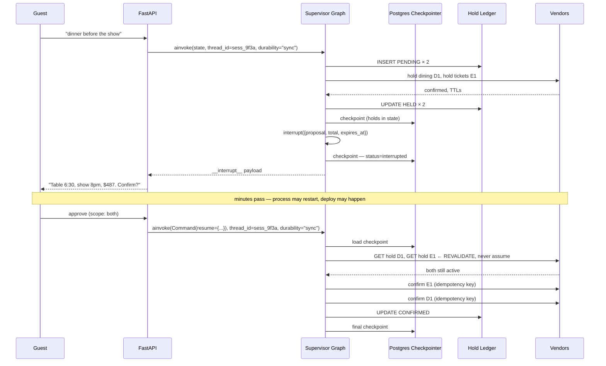

# ResortFlow — HITL, Durability Modes & Workflow State Persistence

*Verified against LangGraph checkpointer and durable-execution docs, September 2026.*

---

## 1. The Three Durability Modes — and the nuance that surprises people

LangGraph supports three durability modes, set per graph execution call — `graph.ainvoke(..., durability="sync")`:

| Mode | Behaviour | Crash recovery mid-execution |
|---|---|---|
| `"exit"` | Persists **only when execution exits** — successfully, with an error, **or due to a human-in-the-loop interrupt** | ❌ None |
| `"async"` | Persists asynchronously while the next step executes | ⚠️ Small risk of loss if the process crashes during execution |
| `"sync"` | Persists synchronously before the next step starts | ✅ Every checkpoint written before continuing |

### The assumption most people get wrong

**"HITL requires `sync`" is false.** An interrupt *is* an exit. Even under `"exit"`, LangGraph persists state when the graph pauses for human input. So a plain approve/reject workflow works correctly on the fastest mode.

That matters because it reframes the real question. The question is not *"does my interrupt survive?"* — it always does. The question is:

> **What did the graph already do to the outside world before it reached the interrupt?**

For ResortFlow, the answer is: it placed holds in three separate vendor systems. And *that's* what decides the durability mode.

### The failure that costs money

Under `"exit"` mode:

```
fan-out → hold dining (D1) ✓ → hold tickets (E1) ✓ → hold PMS (P1) ✓ → 💥 CRASH
```

No checkpoint was written. On restart there is no record that D1, E1 and P1 exist. Three vendor systems have inventory locked against a conversation that no longer exists in your state store. Nothing releases them until TTL expiry — and if the TTL is long, or the vendor doesn't auto-expire, that's a manual remediation ticket per orphaned hold.

Under `"sync"`, each superstep is durable before the next begins, so the crash leaves a checkpoint containing D1, E1 and P1, and the recovery path can release them.

---

## 2. ResortFlow's Durability Policy

Durability is a **per-invocation** parameter, and the intent router runs *outside* the supervisor graph. So classification is already done before the graph is invoked, and mode selection is free.

```python
DURABILITY_BY_INTENT = {
    "informational":  "async",   # "what time does the spa close" — nothing to lose
    "read_only":      "async",   # folio enquiry, loyalty balance
    "mutating":       "sync",    # anything that will place a hold
    "commit_resume":  "sync",    # resuming after approval — always sync
}

result = await supervisor.ainvoke(
    state,
    config={"configurable": {"thread_id": session_id}},
    durability=DURABILITY_BY_INTENT[route.intent_class],
)
```

**The trade-off:** `sync` adds a database round-trip per superstep — measured at roughly 15–40ms against Postgres in the same region. On a mutating turn that already spans 4–9 seconds of model and vendor latency, that's noise. On a high-volume informational turn it's a meaningful fraction, which is why those run `async`.

In short: durability is paid for only on turns that can lose money.

### Pending writes make parallel fan-out safe

Beyond superstep checkpoints, LangGraph persists writes at the **node level**: as each node in a superstep finishes, its outputs are written to the `checkpoint_writes` table as task entries linked to the in-progress checkpoint. If another node in the same superstep fails, the successful nodes' writes are already durable and don't re-run on resume.

This is directly load-bearing for ResortFlow. The fan-out superstep runs Dining, Entertainment and Wellness in parallel. If Wellness throws, the dining and ticket holds already recorded are not lost and those nodes are not re-executed — which would otherwise place *duplicate* holds.

Without pending-write recovery, a partial fan-out failure would double-book on every retry.

---

## 3. Why `sync` Is Still Not Enough — the Write-Ahead Hold Ledger

**This is the most important section in this document.**

There is a known open issue in LangGraph: under `durability="sync"`, the persistence order of `put_writes` (a completed task's pending writes) and `put` (the superseding checkpoint) is not enforced — both are submitted to the same background executor thread pool. Whether a crash during `put()` leaves the task's writes durable, and therefore whether resume *replays* them or *re-executes* the node, is decided by the OS thread scheduler.

Combined with the documented replay semantics — on resume the workflow does **not** continue from the same line of code; it identifies a starting point and **replays all steps from there**, re-running tasks and relying on recorded outcomes — the conclusion is unavoidable:

> **The checkpointer is not a system of record for external side effects.** It is a system of record for *conversation state*. Those are different durability requirements and they need different stores.

### The mitigation: write-ahead ledger

Every external mutation is bracketed by writes to a ResortFlow-owned `hold_ledger` table, **outside** the checkpointer:

```
1. INSERT intent      (saga_id, domain, idempotency_key, status='PENDING')   ← before the call
2. CALL vendor        POST /holds  with Idempotency-Key
3. UPDATE result      (hold_id, expires_at, status='HELD')                   ← after the call
```

Now every crash window is recoverable:

| Crash point | Ledger state | Reaper action |
|---|---|---|
| After step 1, before vendor call | `PENDING`, no hold_id | Probe vendor by idempotency key; release if it exists |
| After vendor call, before step 3 | `PENDING`, no hold_id | Same — the idempotency key is the join |
| After step 3 | `HELD` with hold_id | Release directly |

A reaper job runs every 60s: any ledger row in `PENDING` or `HELD` whose `saga_id` has no active thread and no terminal outcome gets released and marked `ORPHAN_RELEASED`.

```sql
CREATE TABLE hold_ledger (
    ledger_id        BIGSERIAL PRIMARY KEY,
    saga_id          TEXT NOT NULL,
    session_id       TEXT NOT NULL,
    tenant_id        TEXT NOT NULL,
    domain           TEXT NOT NULL,              -- dining | entertainment | stay | wellness
    idempotency_key  TEXT NOT NULL UNIQUE,       -- the join key across every crash window
    hold_id          TEXT,                       -- null until vendor responds
    expires_at       TIMESTAMPTZ,
    status           TEXT NOT NULL,              -- PENDING|HELD|CONFIRMED|RELEASED|EXPIRED|ORPHAN_RELEASED
    trace_id         TEXT,
    created_at       TIMESTAMPTZ DEFAULT now(),
    updated_at       TIMESTAMPTZ DEFAULT now()
);
CREATE INDEX ON hold_ledger (status, expires_at);
CREATE INDEX ON hold_ledger (saga_id);
```

**In summary:** ResortFlow uses `sync` durability but does not treat it as the sole record of external effects. There is a known ordering issue between pending writes and checkpoint commits, and resume semantics replay rather than continue, so a node can re-execute. External mutations are therefore write-ahead logged to a ledger the system owns, keyed by idempotency key, with a reaper for orphans. The checkpointer owns the conversation; the ledger owns the side effects.

---

## 4. Where the State Physically Lives

### Local development — Postgres in Docker

`PostgresSaver` / `AsyncPostgresSaver` from `langgraph-checkpoint-postgres`. Call `.setup()` once to create tables.

### Production on Azure — two viable options

| Option | Notes |
|---|---|
| **Azure Database for PostgreSQL Flexible Server** | Same engine as local — zero behavioural drift. B1ms ≈ $13/mo. **Recommended.** |
| **Azure Cosmos DB for NoSQL** | Official `langchain-azure-cosmosdb` checkpointer (`CosmosDBSaver` / `CosmosDBSaverSync`), sync and async, with Microsoft Entra ID authentication. Attractive if you already run Cosmos for the audit store and want managed-identity auth with no connection strings. |

Choose Postgres for the build: identical local and cloud behaviour is worth more than consolidating onto Cosmos. Document Cosmos as the alternative in the ADR, including the reason it is tempting (Entra ID auth, one less datastore).

### The physical schema

Two tables. One row per superstep, one row per node output:

```sql
CREATE TABLE checkpoints (
    thread_id            TEXT NOT NULL,
    checkpoint_ns        TEXT NOT NULL DEFAULT '',   -- '' = root graph; 'node:uuid' = subgraph
    checkpoint_id        TEXT NOT NULL,              -- ULID, lexicographically sortable
    parent_checkpoint_id TEXT,
    type                 TEXT,
    checkpoint           BYTEA,                      -- serialized state
    metadata             JSONB,
    PRIMARY KEY (thread_id, checkpoint_ns, checkpoint_id)
);

CREATE TABLE writes (
    thread_id     TEXT NOT NULL,
    checkpoint_ns TEXT NOT NULL DEFAULT '',
    checkpoint_id TEXT NOT NULL,
    task_id       TEXT NOT NULL,
    task_path     TEXT NOT NULL DEFAULT '',
    idx           INTEGER NOT NULL,
    channel       TEXT NOT NULL,
    type          TEXT,
    value         BYTEA,
    PRIMARY KEY (thread_id, checkpoint_ns, checkpoint_id, task_id, task_path, idx)
);
```

`checkpoint_id` is a ULID, so it sorts lexicographically — "latest" is `ORDER BY checkpoint_id DESC LIMIT 1`, and "by id" is a primary-key equality lookup.

### Subgraph namespaces — a ResortFlow-specific detail

Each checkpoint carries a `checkpoint_ns`: empty string for the root graph, `"node_name:uuid"` for a subgraph, joined with `|` for nesting.

ResortFlow's five domain subgraphs each get their own namespace. Practical consequences:

- `graph.get_state(config)` returns root state only. To inspect what the dining subgraph was doing at the moment of failure you need `subgraphs=True`, which surfaces subgraph snapshots on the `tasks` field.
- A "resume the thread" operation must account for in-flight subgraph state, not just root state.
- Checkpoint row count is higher than the naive estimate — budget storage accordingly.

---

## 5. What's In the State, and How It's Serialized

The checkpoint stores `channel_values`, `channel_versions` and `versions_seen`. For ResortFlow, `channel_values` is the `ResortFlowState` object: identity and tenancy, messages, plan, proposals, holds, confirmations, failures, retrieved context, policy flags, saga log.

### Serialization

The default `JsonPlusSerializer` uses ormsgpack and JSON, handling LangChain/LangGraph primitives, Pydantic v2 models, dataclasses, datetimes and enums. ResortFlow's state uses `TypedDict` with Pydantic models for `Hold`, `Proposal` and `SagaEvent` — all natively supported. **Nothing in state should require the pickle fallback.** If you find yourself reaching for it, the state design is wrong.

### Encryption — do not skip this

Checkpoints contain guest names, phone numbers, dietary requirements (health data) and booking details, sitting in a database as opaque `BYTEA`. Opaque is not encrypted.

Checkpointers can encrypt all persisted state via `EncryptedSerializer`, most easily through `from_pycryptodome_aes()`, which reads an AES key from the `LANGGRAPH_AES_KEY` environment variable:

```python
from langgraph.checkpoint.serde.encrypted import EncryptedSerializer
from langgraph.checkpoint.postgres.aio import AsyncPostgresSaver

serde = EncryptedSerializer.from_pycryptodome_aes()   # key from Key Vault → env
checkpointer = AsyncPostgresSaver.from_conn_string(CONN, serde=serde)
await checkpointer.setup()
```

Key lives in Azure Key Vault, injected as an env var by Container Apps. This is application-layer encryption *on top of* transparent database encryption — the point being that a Postgres backup restored elsewhere still doesn't yield guest health data.

**Rationale:** dietary requirements are health data under most privacy regimes. They are in the conversation state, so the state is encrypted at the serializer layer with a Key Vault-managed key, independent of the database's own encryption at rest.

### Storage growth and DeltaChannel

By default every superstep writes the full value of every channel, so append-heavy channels like `messages` grow checkpoint size over a long thread. `DeltaChannel` stores incremental deltas instead — but it requires `langgraph>=1.2` and is currently in beta.

For ResortFlow: use standard channels now, cap conversation history with a windowing reducer (keep last N turns plus a rolling summary), and note DeltaChannel in the ADR as the optimization to revisit once it's stable. Avoid building on a beta API whose on-disk representation may change.

---

## 6. The Interrupt Lifecycle, Step by Step



### Code

```python
# Inside the approval node
from langgraph.types import interrupt, Command

def approval_node(state: ResortFlowState):
    decision = interrupt({
        "type": "booking_approval",
        "proposal": state["proposals"],
        "total_amount": compute_total(state["proposals"]),
        "holds_expire_at": min(h.expires_at for h in state["holds"]),
        "approval_scope": [p.domain for p in state["proposals"]],
    })
    return {
        "awaiting_approval": False,
        "approval_scope": decision["approved_domains"],   # granular — subset allowed
    }

# Resuming
await supervisor.ainvoke(
    Command(resume={"approved_domains": ["dining", "entertainment"]}),
    config={"configurable": {"thread_id": session_id}},
    durability="sync",
)
```

`thread_id` is the persistent cursor: reusing it resumes the same checkpoint; a new value starts a fresh thread with empty state. Getting this wrong — generating a new thread ID on resume — silently starts a new conversation and strands the holds.

---

## 7. Resume Safety

Three rules, each derived from documented behaviour.

**Rule 1 — Always revalidate holds before commit.**
Human latency is unbounded; hold TTLs are not. Never trust `state["holds"]` on resume. `GET /holds/{id}` on every hold first. This is a deterministic node, not an agent decision.

**Rule 2 — Every side-effecting node must be idempotent.**
Resume replays steps from a starting point rather than continuing from the stopped line, and a task that started but failed to complete is re-run. Idempotency keys are mandatory, not defensive.

**Rule 3 — Interrupts always re-trigger on replay.**
Nodes after a replayed checkpoint re-execute — including LLM calls, API requests, and interrupts, which are *always* re-triggered during replay. So an interrupt node must be safe to hit twice. Practically: the approval node must be able to render the same proposal again without re-placing holds, which means hold placement lives in a node *before* the interrupt, never inside it.

### The fundamental race: hold TTL vs human response time

| Vendor | TTL | Reality |
|---|---|---|
| Ticketing | 480s (8 min) | Guest is at a show; may not check phone for an hour |
| Dining | 600s (10 min) | Same |
| PMS | 900s (15 min) | Same |

You cannot win this race. You can only handle it well:

1. **Surface the deadline** in the approval message — "holds expire at 18:41."
2. **Push notification** at T-2min, not silence.
3. **Revalidate on resume** (Rule 1) and route expired holds to Recovery, which re-acquires and re-proposes rather than failing.
4. **Auto-release** via the reaper when the thread goes cold — don't leave inventory locked.
5. **Never auto-extend** a hold without human input. That's inventory hoarding, and vendors rate-limit for it.

**Design goal:** the hold TTL versus human response time race is unwinnable in the general case. The goal is not to always succeed; it is that an expired hold produces a re-proposal, never a silent failure or a booking the guest did not approve.

---

## 8. Graph Versioning Across Interrupts

A thread can sit interrupted for hours. You deploy `v1.5.0` in the meantime. Now a checkpoint written by `v1.4.2` — node names, state schema, channel set — is resumed by different code.

Failure modes: a renamed node breaks the resume target; an added required state field is absent; a changed reducer merges differently.

Mitigations, in order of cost:

1. **Pin `graph_version` in state** at thread start. On resume, compare — if it differs, decide explicitly rather than discovering it at runtime.
2. **Drain before deploy.** Query threads with `next != ()` and no terminal outcome. If any are interrupted, either wait or notify. In practice ResortFlow's holds expire within 15 minutes, so a drain window is short.
3. **Never rename nodes in a patch release.** Node names are a persistence contract, not an implementation detail. Treat renames as a breaking change.
4. **Additive state changes only.** New fields must have defaults. Removing a field breaks deserialization of older checkpoints.
5. **Reject cross-major resume.** If `graph_version` major differs, don't attempt it — release the holds, apologize, restart the conversation. Better than a corrupt merge.

Graph versioning across interrupts is easy to overlook, and it determines whether a deploy can corrupt in-flight conversations.

---

## 9. Thread Lifecycle & Retention

| Stage | Trigger | Action |
|---|---|---|
| **Active** | Guest engaged | Normal checkpointing |
| **Interrupted** | Awaiting approval | Monitored against hold TTLs |
| **Cold** | No activity, holds expired | Reaper releases holds; thread marked abandoned |
| **Complete** | Terminal outcome recorded | Audit record written to Cosmos |
| **Archived** | 30 days after completion | Checkpoints pruned |

Checkpointers expose `delete_thread` / `adelete_thread` (removing both checkpoint and write rows) and optional `prune` for history pruning.

Retention is deliberately split, because the two stores have different obligations:

- **Checkpoints:** 30 days. Operational debugging and resume. Contains raw conversation.
- **Audit records (Cosmos):** years, per regulator. Decisions only, not conversation.

The audit record carries `trace_id`, `session_id` and `saga_id`, so a compliance query still resolves to a specific interaction long after the checkpoint is gone. The checkpoint is not the audit trail — say that explicitly, it's the same argument as not putting audit records in App Insights.

---

## 10. Checkpointer vs Store — two kinds of memory

| | Checkpointer | Store (`BaseStore`) |
|---|---|---|
| Scope | One thread | Cross-thread, per guest |
| Holds | Conversation state, holds, plan, saga log | Durable preferences: dietary defaults, seating preference, venue history |
| Lifetime | 30 days | Life of the guest relationship |
| ResortFlow use | Everything in `ResortFlowState` | "Prefers booth seating", "shellfish allergy — severe", "dislikes the seafood tower" |

A returning guest's shellfish allergy must **not** live only in a 30-day checkpoint. It belongs in the Store, is loaded into state at thread start, and is re-confirmed with the guest rather than silently assumed.

**That re-confirmation is deliberate:** a stale allergy record is a safety risk, so the agent surfaces it as a question — "I have a severe shellfish allergy on file for your wife; is that still right?" — rather than passing it to the kitchen unverified. Long-term memory informs the conversation; it doesn't bypass it.

---

## 11. Failure Matrix

| Failure | Mode | Recovery |
|---|---|---|
| Crash mid-fan-out | `sync` | Checkpoint has partial holds; ledger has all intents; reaper releases orphans |
| Crash mid-fan-out | `exit` | ❌ No checkpoint. Ledger is the *only* recovery path — this is why it exists |
| One node fails in parallel superstep | any | Pending writes preserve successful nodes; no duplicate holds on retry |
| Crash while interrupted | any | Interrupt is an exit; state persisted; resume normally |
| Hold expires during human wait | any | Revalidation on resume → Recovery re-acquires and re-proposes |
| Vendor confirm times out | any | Idempotency key; retry is safe; ledger reconciles |
| Deploy during interrupt | any | Version pin comparison; drain or explicit reject |
| Checkpoint write fails | `sync` | Execution halts before next step — correct behaviour, fail loudly |
| Compensation itself fails | any | DLQ + saga log + duty-manager page + honest guest message |

---

## 12. Design FAQ

**"What durability mode do you use for HITL?"**
`sync`. An interrupt is itself an exit, so even `exit` mode persists state when the graph pauses. The reason for `sync` is that ResortFlow places holds in three vendor systems *before* reaching the interrupt. Under `exit`, a crash mid-fan-out leaves inventory locked in vendors with no state record. It's selected per-invocation: `sync` for mutating turns, `async` for informational ones, because durability is only paid for on turns that can lose money.

**"Is `sync` enough?"**
No. There is a known ordering issue between pending writes and checkpoint commits under `sync`, and resume replays rather than continues — so a node can re-execute. The checkpointer is not treated as the system of record for external side effects. Mutations are write-ahead logged to a ledger the system owns, keyed by idempotency key, with a reaper for orphans. Checkpointer owns the conversation; ledger owns the side effects.

**"Where does state actually live?"**
Two tables — one row per superstep, one row per node output, keyed by `thread_id` plus checkpoint namespace plus a ULID checkpoint ID. Postgres locally and in Azure, so behaviour is identical both sides. Cosmos DB has an official checkpointer with Entra ID auth and is the documented alternative, but engine parity between local and cloud was worth more than consolidating datastores.

**"State contains guest health data. How is it protected?"**
Encrypted at the serializer layer with `EncryptedSerializer`, AES key from Key Vault. That's on top of transparent database encryption — the point is that a restored backup still doesn't yield dietary or contact data. Retention is 30 days; the long-lived record is the audit store, which holds decisions, not conversation.

**"What if the guest approves an hour later and the holds are gone?"**
Revalidate every hold before commit — never trust state. Expired holds route to Recovery, which re-acquires and re-proposes rather than failing. The race between hold TTL and human response time is unwinnable in general, so the design goal is that expiry produces a re-proposal, never a silent failure or an unapproved booking.

**"What happens if you deploy while a thread is interrupted?"**
Graph version is pinned in state at thread start and compared on resume. Node names are a persistence contract, so renames are breaking changes, and state changes are additive with defaults. Cross-major resume is rejected outright — release the holds and restart the conversation rather than risk a corrupt merge. In practice holds expire inside 15 minutes, so the drain window is short.

**"How does parallel fan-out not double-book on retry?"**
Node-level pending writes. Each node's output is durable as it completes, linked to the in-progress checkpoint, so a failure elsewhere in the superstep doesn't re-run the nodes that succeeded. Without that, every partial fan-out failure would place duplicate holds on retry.

---

*Sources: LangGraph checkpointer and durable-execution documentation, and langchain-ai/langgraph issue #8039, verified September 2026. APIs shift between versions — re-verify before implementation.*
