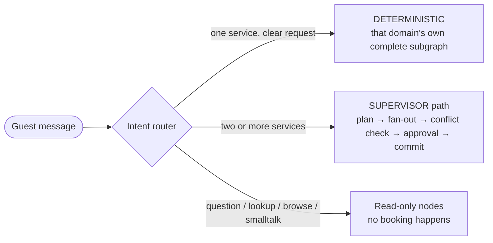
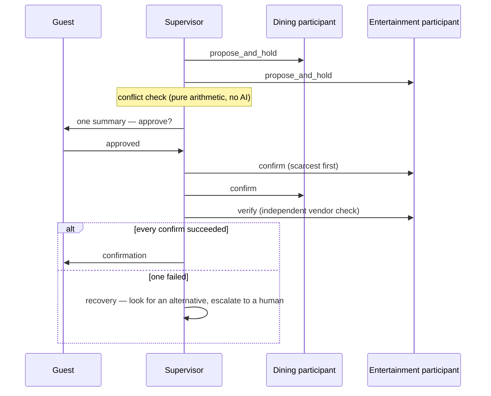
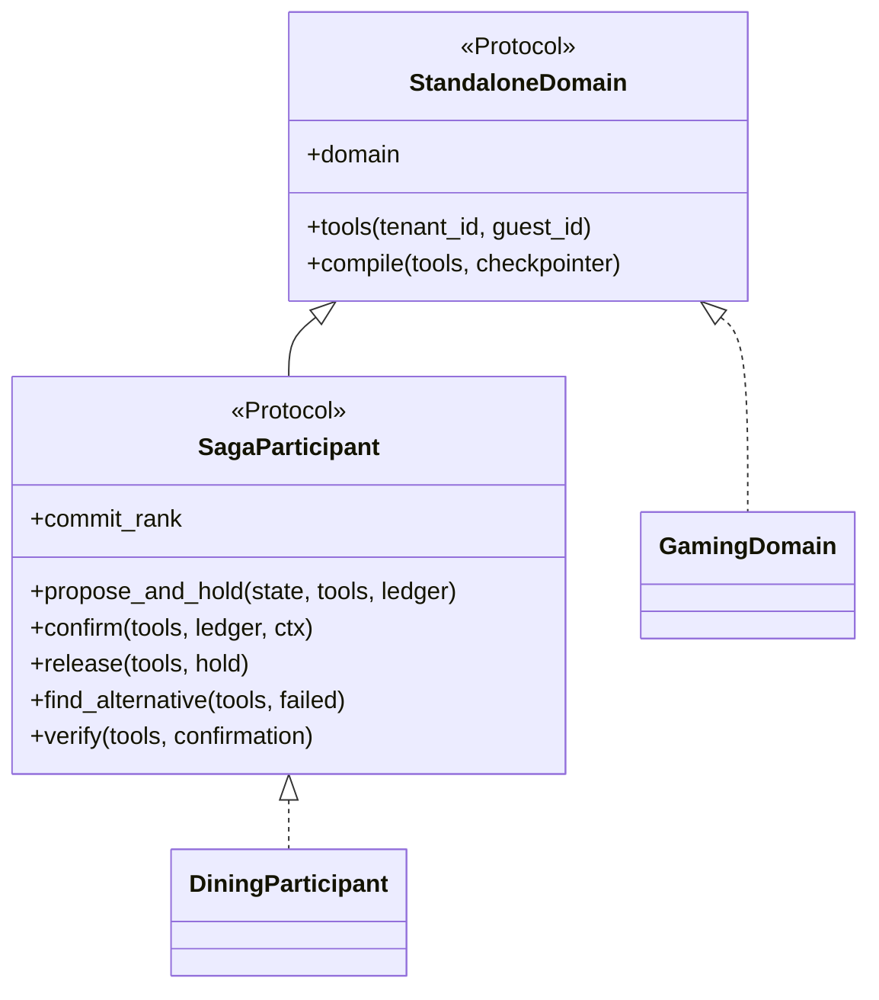
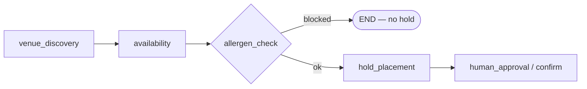

# ResortFlow Supervisor Architecture — a layered guide

**Who this is for:** anyone who needs to understand, change, or defend how ResortFlow coordinates a
guest's request across dining, entertainment, wellness, stay, and gaming.
**How to read it:** the sections go from basic to deep. Stop at the layer you need.

| Layer | You get | Sections |
|---|---|---|
| 1. The idea | What the supervisor is for, in plain words | §1 |
| 2. The concepts | The few terms everything else is built from | §2–§3 |
| 3. The map | Where each responsibility lives in code | §4–§5 |
| 4. The contract | What a domain must provide to plug in | §6 |
| 5. Doing things | Add a domain, and where *not* to edit | §7–§8 |
| 6. The depth | Why it is built this way, and the sharp edges | §9–§12 |
| 7. Reference | Tests, glossary, decisions | §13–§15 |

Decision record for this structure: [ADR-061](adr/061-domain-saga-participants-and-supervisor-decomposition.md).

---

## 1. The idea in one minute

A guest writes: *"Dinner and a show on Friday at 7, party of two, severe peanut allergy."*

That is three jobs: a **dinner** booking, a **show** booking, and an **allergy** that must never be
ignored. Each job belongs to a different system (a restaurant system, a ticketing system) with its
own rules. The **supervisor** is the coordinator that makes them happen *together or not at all*:

1. Work out **what the guest wants** (which services, is it a question or a booking?).
2. Ask each service to **hold** something temporarily (a table, seats), without buying it.
3. Check the holds **don't clash** (you cannot be at a show and a dinner at the same minute).
4. Show the guest **one summary** and ask once: *"Shall I book all of this?"*
5. If yes, **confirm each hold in a safe order**. If one fails, **undo or recover** the rest.

Everything else (policy rules, replies, resuming a conversation next day) exists to make those five
steps safe and repeatable.

> **Analogy.** A wedding planner who holds the venue, the caterer and the band tentatively, checks
> the dates fit, gets one "yes" from the couple, then signs the contracts one by one — and if the
> band falls through, releases what can be released and tells the couple honestly.

## 2. Five rules that shape every decision

These come from [AGENTS.md](../AGENTS.md) and are not negotiable without an ADR.

1. **Only use the AI where intent is genuinely unclear.** About 60% of requests never enter the
   multi-agent graph; plain code handles them.
2. **All tools go through MCP.** No agent talks to a vendor directly.
3. **Every real-world change is two steps: hold, then confirm.** Nothing irreversible happens in one call.
4. **Policy is code, not a prompt.** Allergy handling, responsible gaming and jurisdiction rules are enforced
   before and after the model, in ordinary code.
5. **State is durable.** Every step is checkpointed; any conversation can be replayed or resumed.

## 3. The two ways a request can travel

Not every request needs the whole saga. The router picks one of two paths:



| Path | When | Who owns approval and confirm |
|---|---|---|
| **DETERMINISTIC** | One service, unambiguous (*"table for 4 at 7"*) | The domain's *own* subgraph — it asks for approval and confirms itself |
| **SUPERVISOR (saga)** | Several services in one request | The supervisor — **one** approval, then an ordered commit across all domains |
| **Read-only** | FAQ, "what's my booking?", "what's on Friday?", greetings | Nothing is booked |

The important point: the saga path **does not run each domain's subgraph**. It reuses the domain's
building blocks (discover → check availability → place hold) and stops before approval, because
approval and confirmation now belong to the supervisor.

## 4. The saga in plain words

A **saga** is a multi-step business transaction that has no single "undo" button, so each step has
a matching *compensation*.



Key properties, each enforced in code:

- **Phase 1 (hold) is reversible**; phase 2 (confirm) is the only commit.
- **Commit order is fixed**, least flexible first: entertainment → dining → wellness → stay.
  A show with fixed times is hard to replace; a room rarely is.
- **A failure never aborts the loop** — later domains still try — then `CommitVerify` decides if
  recovery is needed.
- **Recovery never double-books.** An alternative it finds is reported as a *lead for a human*, not
  committed automatically.
- **A hold in memory is never trusted on resume.** Each domain's confirm step re-checks the vendor first.

## 5. Where everything lives

```
graph/
  participants.py      The abstractions: StandaloneDomain, SagaParticipant, ConfirmContext, DomainRegistry
  domains.py           Composition root — the ONE place that lists the concrete domains
  supervisor/          The orchestration, one responsibility per file
    __init__.py          Facade. Re-exports everything, so `from graph.supervisor import X` still works
    common.py            Shared constants and tiny pure helpers; the registry handle
    session.py           Entry node, turn baselines, new_session_state
    intent.py            Intent router + clarification loop
    read_paths.py        Knowledge Q&A, booking lookup, browse, decline, smalltalk, modify hand-off
    deterministic.py     Single-domain dispatch to a standalone subgraph
    subgraph_bridge.py   Sub-thread identity, interrupt forwarding, duplicate suppression
    policy_gates.py      Policy pre/post-flight, blocked reply, Offer Agent, human hand-off
    planning.py          Planner, fan-out, conflict check, proposal assembly, approval gate
    saga.py              Commit, verify, recovery, release — no per-domain branches
    respond.py           Guest-facing reply composition
    topology.py          Graph assembly only: register nodes, wire edges
agents/
  _shared/pipeline.py  The propose-and-hold skeleton every domain shares
  <domain>/participant.py   Each domain's own adapter (dining, entertainment, wellness, stay; gaming is read-only)
```

**Rule of thumb for "where do I edit?"**

| I want to change… | Edit | Never edit |
|---|---|---|
| How dining discovers a venue or places a hold | `agents/dining/…` | `graph/supervisor/` |
| Which vendor verb releases a seat | `agents/entertainment/participant.py` | `graph/supervisor/saga.py` |
| The order domains are committed | `commit_rank` on each participant | a list in the supervisor |
| How the router classifies a sentence | `graph/routing/` | `graph/supervisor/intent.py` |
| The wiring between nodes | `graph/supervisor/topology.py` | any node module |
| The saga's own commit/recovery rules | `graph/supervisor/saga.py` | a domain participant |

## 6. The contract a domain must meet

Defined in [graph/participants.py](../graph/participants.py). There are **two small interfaces**, not one large one.



- **`StandaloneDomain`** — every domain, including gaming: how to get its tools and its own compiled subgraph.
- **`SagaParticipant`** — only domains that *change* something. Gaming is deliberately **not** one, so
  the "gaming is read-only" hard rule is enforced by the type system and by a test, not by convention.

What each saga method promises (and `agents/tests/test_participant_contract.py` checks):

| Method | Promise |
|---|---|
| `propose_and_hold` | Returns a state **delta** (never a bare tuple), so reducers still work. Must **not** set `awaiting_approval` / `approval_scope` — the supervisor owns that decision. |
| `confirm` | Re-validates against the vendor before confirming. Receives only a `ConfirmContext` (proposal, hold, guest id, saga id) — nothing else. |
| `release` | Idempotent. Translates to the vendor's **own** verb (`release_hold`, `release_seat_hold`, `release_amenity_hold`, `release_room_hold`) using the key `"<hold key>:release"`. |
| `find_alternative` | Tolerates `None`. Returns a *candidate*, never commits it. |
| `verify` | `True`/`False` from a real vendor round-trip, or **`None` when the vendor offers no status check**. `None` means "unverified", never "passed". |

> **Why the verbs differ.** `release_seat_hold` vs `release_hold` is the vendors' real vocabulary, frozen
> in the MCP/OpenAPI contracts. We do not rename it; each participant **translates** it. That is an
> anti-corruption layer, not a design flaw.

## 7. How to add a new domain (for example, airport transport)

Do these in order. Nothing in `graph/supervisor/saga.py` or `planning.py` changes.

1. **Vendor surface** — add the simulator and MCP gateway server for the vendor (Tracks A and B).
2. **`Domain` enum** — add the member in `graph/models.py`.
3. **Node name** — add the constant in `graph/nodes.py` and to `ALL_NODES`. Node names are a persistence
   contract, so this is *additive only* and warrants a **minor** `GRAPH_VERSION` bump.
4. **Domain package** — `agents/transport/` with intent parser, discovery, hold-placement and confirm nodes,
   plus its own standalone graph. Reuse `agents/_shared/pipeline.run_propose_and_hold`.
5. **Participant** — `agents/transport/participant.py` implementing `SagaParticipant`; choose a `commit_rank`.
6. **Register it** — one line in `graph/domains.py`. This is the single place the supervisor learns a domain exists.
7. **Routing vocabulary** — add words to `graph/routing/vocabulary.yaml` so the router can recognise it.
8. **Tests** — add the domain to `MUTATING` in `agents/tests/test_participant_contract.py`; update the golden
   topology (`RESORTFLOW_UPDATE_GOLDEN=1`) and review the diff as part of an ADR.

An honest limit: a new domain still costs **one node constant and one registration**. It does not cost
*logic edits* in the supervisor. That is the real Open/Closed guarantee here.

## 8. What you must not change casually

| Invariant | Why |
|---|---|
| Node names | They key checkpoints. Renaming one orphans every in-flight conversation. Golden test pins them. |
| Sub-thread id `{session_id}:deterministic:{domain}` | Same reason — it identifies inner checkpoints. |
| Fan-out registration order (dining, entertainment, wellness, stay) | It decides the append order of parallel writes. |
| `GRAPH_VERSION` major | A major bump releases every outstanding hold on the first resumed turn. Minor bumps are additive. |
| `tenant_id` source | Always the verified token claim, injected server-side. Never model output. |
| The `policy_blocked` guard on hold routing | Defence in depth: a blocked state must never reach approval or confirm. |

---

## 9. Deep dive — one allergen decision, two callers

**The problem we found.** The standalone dining graph and the multi-domain path each had their own
copy of the allergen logic, and they behaved differently:

| Path | Before | Now |
|---|---|---|
| Multi-domain | Blocked **before** any hold was placed (a duplicate, inline copy of the check) | Same |
| Standalone dining | Placed the hold **first**, then blocked, leaving it to the TTL reaper | **Blocked before any hold** |

A guest who could never confirm was tying up real vendor inventory, and the same sentence got a
different guarantee depending on whether it also mentioned a show.

**The fix.** [agents/dining/nodes/allergen_check.py](../agents/dining/nodes/allergen_check.py) now exposes a
pure function `evaluate_allergens(state, proposal)` returning an `AllergenVerdict`. The standalone
`allergen_check` node and `DiningParticipant.propose_and_hold` both call it. In the standalone graph,
a new conditional edge `route_after_allergen_check` ends the flow before `hold_placement`.



Verified by `agents/tests/test_allergen_path_parity.py`: same conversation, both paths, **no `hold_table` call**.

## 10. Deep dive — the sub-thread bridge

`DETERMINISTIC` calls a *separate* compiled graph by hand rather than mounting it as a LangGraph
subgraph node. That has three consequences, all isolated in
[subgraph_bridge.py](../graph/supervisor/subgraph_bridge.py):

1. **Own thread id.** The inner graph's checkpoints live under `{session_id}:deterministic:{domain}`.
2. **Manual interrupt forwarding.** A nested `interrupt()` does not reach the outer graph for free.
   The bridge forwards it, and on resume feeds the guest's answer to the inner graph's pending interrupt.
   *Disclosed limitation:* on the pass where the inner graph first interrupts, the outer snapshot shows
   `__interrupt__` but not yet `holds`/`proposals`. Treat `__interrupt__` as the signal.
3. **Duplicate suppression (ADR-058).** Append-only channels (`confirmations`, `failures`, `saga_log`,
   `policy_flags`) would otherwise be appended twice — once by the inner history, once copied from
   the outer. That bug once recorded a booking twice. The bridge forwards only *new* messages and
   copies back only *new* confirmations.

**Why not mount the subgraph properly?** It would remove this code, but it changes the checkpoint
identity: a `GRAPH_VERSION` major bump and its own ADR. We isolated the complexity instead of
changing a persistence contract in a refactor.

## 11. Deep dive — fan-out and the approval keys

`PLANNER` fans out to one node per saga domain in a single LangGraph superstep. Two details matter:

- **Order is load-bearing.** Registration order fixes node insertion order, which fixes the append order
  of parallel writes to `proposals`. Commit order is a *separate* concept (`commit_rank`). The registry
  exposes both: `fanout_domains()` and `commit_order()`.
- **Branches must not write the approval keys.** `awaiting_approval` is a plain last-value channel; two
  branches writing it in one superstep raises `InvalidUpdateError`. The fan-out node strips both
  `awaiting_approval` and `approval_scope` once, at its own boundary. That is why the participant
  contract says `propose_and_hold` must not set them.

## 12. Deep dive — resume safety

Because every step is checkpointed, a conversation can resume hours later. Two rules protect it:

- **Never trust `state["holds"]` on resume.** `confirm` re-validates with the vendor and may find the
  hold expired. The ledger (Postgres) is the durable source of truth, not conversation state.
- **Compatibility is by additive change.** This refactor changed *structure*, not state: `ResortFlowState` is
  still 25 keys, `GRAPH_VERSION` is still 5.2, node names are identical (golden-tested). One edge inside
  the dining subgraph changed (§9); no node name did.

---

## 13. How it is tested

| Test | Protects |
|---|---|
| `graph/tests/test_topology_golden.py` | Node and edge set of the supervisor graph — a rename or rewire fails here |
| `agents/tests/test_participant_contract.py` | Every participant honours the saga contract; gaming cannot be a participant; fan-out and commit order |
| `agents/tests/test_allergen_path_parity.py` | Standalone and multi-domain dining enforce identical allergen policy, no hold on a block |
| `agents/dining/tests/test_blocked_routing_structural.py` | A blocked state never reaches approval or confirm |
| `agents/tests/test_*` (≈40 files) | Behaviour through the public facade: multi-domain itineraries, recovery, release, resume, policy |

Run the suite in the Linux container (the Windows host blocks some native wheels):

```bash
docker compose --profile test run --rm tests python -m pytest agents graph policy -p no:schemathesis -q
```

One test, `test_tenant_isolation.py::test_no_client_supplied_field_can_override_the_verified_tenant`,
fails on the **original** commit too. The gateway correctly rejects the injected `tenant_id`, so the
mocked upstream is never called and the test's helper raises `KeyError`. The isolation invariant holds;
the test's assertion needs rewording by its owner.

## 14. Glossary

| Term | Meaning |
|---|---|
| **Saga** | A multi-step transaction where each step has a compensating action instead of one rollback |
| **Participant** | A domain that takes part in the saga (hold, confirm, release, recover, verify) |
| **Hold** | A temporary, reversible claim on inventory (a table, seats, a room) |
| **Fan-out** | Running every domain's propose-and-hold in parallel in one graph step |
| **Facade** | `graph/supervisor/__init__.py` — keeps the old import path working after the split |
| **Composition root** | `graph/domains.py` — the single place that wires concrete classes to abstractions |
| **Anti-corruption layer** | Code that translates between our vocabulary and a vendor's, so vendor naming never leaks inward |
| **Golden test** | A test comparing output to a committed snapshot; changing it is a deliberate, reviewed act |
| **Persistence contract** | A name or id stored in checkpoints; changing it breaks resume of existing conversations |
| **Reducer** | The rule LangGraph uses to merge concurrent writes into one state key |

## 15. Related records

- [ADR-061](adr/061-domain-saga-participants-and-supervisor-decomposition.md) — this structure, with options considered
- [ADR-029](adr/029-policy-block-routing-and-flag-reducer.md) — policy-block routing (amended by ADR-061)
- [ADR-058](adr/058-turn-scoped-booking-reporting.md) — the duplicate-confirmation fix the bridge preserves
- [ResortFlow-HITL-Durability-State.md](ResortFlow-HITL-Durability-State.md) — durability modes and resume safety
