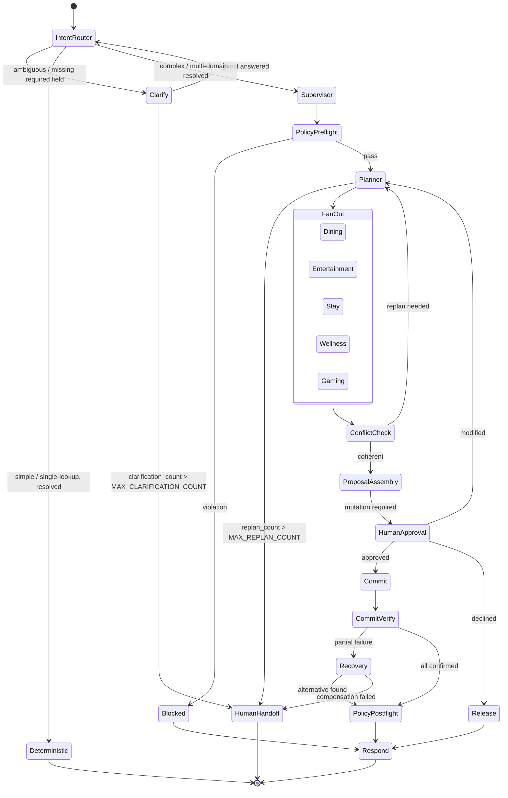

# Interface Contract: Graph Topology (feature 005 resolution)

**Feature**: `005-multi-agent-orchestration` | Amends: `docs/ResortFlow-Enterprise-Multi-Agent-Plan.md` §4's `stateDiagram-v2`

This document is the authoritative, implementation-ready topology for this feature's
compiled supervisor graph. It resolves the two ambiguities the enterprise plan doc's
diagram left open (`OFFER_AGENT`, `HUMAN_HANDOFF` — ADR-020) and adds the one new node
this feature introduces (`CLARIFY` — ADR-024). It does not replace the enterprise plan
doc, which remains the source of the overall vision; this is the frozen, buildable
version of it for this feature.

## Resolved topology

## Node name registry (this feature's additions and resolutions)

| Node | `graph.nodes` constant | Status this feature |
|---|---|---|
| Clarify | `CLARIFY` | **New** (additive, ADR-024) |
| Human Handoff | `HUMAN_HANDOFF` | **Now compiled** — was reserved-unmounted (ADR-020) |
| Offer Agent | `OFFER_AGENT` | **Still reserved, not compiled** (ADR-020) |
| Entertainment / Stay / Wellness / Gaming | `ENTERTAINMENT`, `STAY`, `WELLNESS`, `GAMING` | **Now compiled** — names existed, no subgraph did |
| All other nodes | *(unchanged)* | Unchanged from feature 004 |

## `Release` and FR-022

`HumanApproval --> Release: declined` is the only reachable point in this topology for
"guest explicitly cancels after holds exist but before commitment" (spec.md FR-022) —
every step between `FanOut` and `HumanApproval` runs as one uninterrupted turn, so there
is no other point a guest's cancellation could arrive. Explicit cancellation is treated
as the same event as declining (ADR-026) — no separate edge or signal. `Release` MUST
proactively release every outstanding hold for the itinerary immediately (not wait for
expiry) — FR-022's exact requirement.

## Escalation edges (Constitution Principle V compliance)

Every cyclic path in this topology has an explicit, bounded escalation edge to
`HumanHandoff`:

| Cycle | Bound | Escalates via |
|---|---|---|
| `IntentRouter <-> Clarify` | `MAX_CLARIFICATION_COUNT` (2) | `clarification_count`, `escalate_reason="clarification_bound"` |
| `Planner -> FanOut -> ConflictCheck -> Planner` (includes `HumanApproval -> Planner: modified`) | `MAX_REPLAN_COUNT` (3) | `replan_count`, `escalate_reason="replan_bound"` |
| `Recovery` compensation failure | N/A (not a cycle — a terminal failure of a single attempt) | `escalate_reason="compensation_failed"` |

## Durability mode per new edge

Per `ResortFlow-HITL-Durability-State.md`'s `DURABILITY_BY_INTENT` table, extended:

| Route | Durability |
|---|---|
| `Clarify` turn (interrupt + resume) | `sync` — blocks any downstream commitment |
| `HumanApproval` (existing) | `sync` — unchanged |
| `FanOut` domain subgraph steps | `sync` — every step may place a hold |
| `Deterministic` path | `async` — unchanged, nothing to lose |

## What this contract does not cover

The Policy Engine's actual pre/post-flight rule logic (Phase 6). `PolicyPreflight` and
`PolicyPostflight` are pass-through nodes in this feature — they exist in the topology so
the shape matches the frozen registry and so Phase 6 has a real attachment point, but
they perform no compliance evaluation yet. This is a deliberate scope boundary
(spec.md's "Out of Scope" via the Assumptions section), not an oversight.
